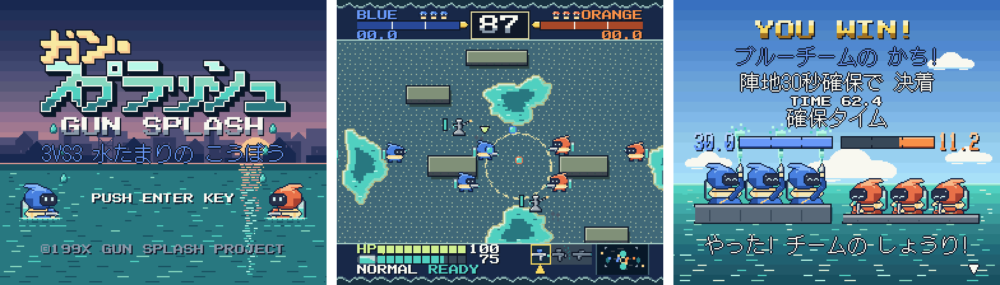

# ガン・スプラッシュ

**[English version below.](#english)**

ブラウザで遊ぶ、3対3の水鉄砲陣取りゲームです。限られた水を補給しながら、中央の陣地を取り合います。画面は「16ビット家庭用ゲーム機のソフトの復刻版」を意識したドット絵です。



## 遊び方

Node.js 22 以上で、このフォルダーから次を実行し、ブラウザで http://127.0.0.1:4173 を開きます。

```sh
npm start
```

サーバーなしで遊ぶときは、1ファイル版を作ってダブルクリックで開きます（インターネットにつながっていなくても動きます）。

```sh
npm run build    # play.html ができます
```

PCとスマホ・タブレットのブラウザに対応しています。音ははじめOFFです（起動画面の「あそぶ（音あり）」で始めるか、［設定］でONにします）。

## ルール

- あなた＋仲間のBOT2体（BLUE）と、BOTの3体（ORANGE）の対戦。1試合は90秒です。
- 中央の陣地を合計30秒確保するか、相手を全滅させれば勝ち。時間切れのときは確保時間の長いほうが勝ちです。
- 水鉄砲は水を使います。水たまりに入るとタンクに補給でき、ポンプのそばで止まると水たまりに水を足せます。ステージの水には限りがあり、なくなると最後の15秒になります。
- 武器は3種類です。
  - **ノーマル**：中距離の連射
  - **スプラッシュ**：近距離に広がる散弾
  - **ロングバレル**：ためて撃つ、貫通する遠距離弾
- ステージは入門から上級までの4つです。順番に勝つと次が開き、上級で勝つと、なぞのスペシャルステージも遊べるようになります。くわしいルールは、ゲーム内の取扱説明書にあります。

## 操作

| | PC | スマホ・タブレット |
|---|---|---|
| 移動 | WASD／矢印キー | 画面の左側に触れて指を動かす |
| ねらう | マウス | 移動の向き（自動で照準補正） |
| うつ | 左クリック（ロングバレルは長押し） | 画面の右側を押す |
| 武器を切り替え | E／右クリック | ［ぶき］ボタン |
| ポーズ | Esc／P | ［ポーズ］ボタン |
| すぐやりなおし | R | ポーズメニュー |

## 開発

依存パッケージはありません。`src/` がゲーム本体で、ビルドせずにそのまま静的配信できます（`src/index.html` から始まります）。

```sh
npm test         # テスト（tests/）
npm run build    # src/ から 1ファイル版の play.html を作る
npm run fonts    # フォント（src/fonts/）とゲーム画面の文字データを作り直す（要インターネット）
```

フォントは、ゲームと説明書で使う文字だけを収めたサブセットです。ゲーム画面の文字は、そのフォントの輪郭から作った点のデータ（`src/js/j16-atlas.js`）で描くので、どの端末でも同じ見た目になります。新しい文字を使う文を足したら `npm run fonts` を実行します（必要なときはテスト時に通知されます）。

## ライセンス

[MIT License](LICENSE)。

`src/fonts/` に同梱しているフォント（DotGothic16、BIZ UDPGothic、Dela Gothic One、M PLUS Rounded 1c）は、どれも [SIL Open Font License 1.1](https://openfontlicense.org/) です。それぞれのライセンス文は同じフォルダーの `*-OFL.txt` にあります。

---

## English

Gun Splash (ガン・スプラッシュ) is a 3-vs-3 water-pistol turf battle that runs in the browser. Refill your limited water and fight over the zone in the middle. It is drawn in pixel art and presented as a re-release of a game for a 16-bit home console.

### How to play

With Node.js 22 or later, run this in this folder and open http://127.0.0.1:4173 in your browser.

```sh
npm start
```

To play without a server, build the single-file version and double-click it (it works offline, too).

```sh
npm run build    # creates play.html
```

It works in browsers on PCs, phones and tablets. Sound starts off; choose "あそぶ（音あり）" (play with sound) on the start screen, or turn it on in [設定] (settings). The game's text is in Japanese.

### Rules

- You and two bot allies (BLUE) play against three bots (ORANGE). A round lasts 90 seconds.
- Hold the center zone for 30 seconds in total, or knock out the whole other team, to win. When time runs out, the team that held the zone longer wins.
- Your water gun uses water. Step into a puddle to refill your tank; stand still by a pump to add water to its puddle. Each stage has a limited amount of water; when it is gone, the last 15 seconds begin.
- There are three weapons:
  - **Normal**: rapid fire at mid range
  - **Splash**: a short-range spread
  - **Long barrel**: a charged, piercing long-range shot
- There are four stages, from beginner to advanced. A win opens the next one, and a win on the advanced stage opens a mystery special stage. The full rules are in the in-game manual (the [せつめいしょ] (manual) button, in Japanese).

### Controls

| | PC | Phone / tablet |
|---|---|---|
| Move | WASD / arrow keys | Touch the left side of the screen and move your finger |
| Aim | Mouse | Your movement direction (with aim assist) |
| Shoot | Left click (hold for the long barrel) | Press the right side of the screen |
| Switch weapon | E / right click | The [ぶき] (weapon) button |
| Pause | Esc / P | The [ポーズ] (pause) button |
| Restart at once | R | Pause menu |

### Development

There are no dependencies. `src/` is the game itself and can be served as static files without a build (the entry point is `src/index.html`).

```sh
npm test         # run the tests (tests/)
npm run build    # build the single-file play.html from src/
npm run fonts    # rebuild the fonts (src/fonts/) and the in-game text glyphs (needs the internet)
```

The fonts are subsets that hold only the characters the game and the manual use. The in-game text is drawn from dot glyphs made from that font's outlines (`src/js/j16-atlas.js`), so it looks the same on every device. After adding text with new characters, run `npm run fonts` (the tests tell you when).

### License

[MIT License](LICENSE).

The fonts bundled in `src/fonts/` (DotGothic16, BIZ UDPGothic, Dela Gothic One, M PLUS Rounded 1c) are all under the [SIL Open Font License 1.1](https://openfontlicense.org/). Their license texts are the `*-OFL.txt` files in the same folder.
